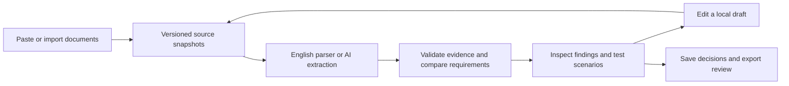

# BriefCheck — Hackathon Instruction Review

> **Catch conflicting rules and missing requirements before participants do.**

BriefCheck gives hackathon organizers one workspace to compare event instructions, inspect the evidence behind a finding, test its consequences, and verify a correction. Every review preserves the source versions that produced it.

**English-only proof of concept · React + TypeScript · Node.js · SQLite · Optional OpenAI extraction · MIT**

## Quick Highlights

- **Evidence you can inspect** — exact source passages, verified offsets, and immutable document snapshots.
- **Concrete boundary tests** — see whether the same video duration, team size, or deadline satisfies different instructions.
- **A complete correction loop** — edit a local draft, rerun, and distinguish resolved issues from unchanged findings.
- **Two analysis modes** — deterministic English patterns without an API key, or optional structured AI extraction followed by application checks.
- **Private saved workspaces** — owner, editor, and reviewer roles, reusable templates, and version checks for concurrent edits.
- **Portable review records** — printable HTML and JSON with findings, decisions, evidence, revisions, and saved scenarios.

## The Problem

Event instructions are spread across overviews, official rules, submission guidelines, and FAQs. A small wording difference can change what a participant is allowed to submit.

| Instruction | Exactly 180 seconds |
|---|---|
| “Demo video must be at most 3 minutes.” | Meets the requirement |
| “Demo video must be under 3 minutes.” | Does not meet the requirement |

BriefCheck makes that difference visible, leaves the intended meaning to the organizer, and checks the revised instructions afterward.

## How It Works



AI extraction returns structured requirements; application code verifies source quotes and evaluates supported predicates. Unsupported or unresolved interpretations remain visible. A valid quote does not guarantee a correct interpretation.

### Tech Stack

| Layer | Technology | Purpose |
|---|---|---|
| Interface | React, TypeScript, Vite | Document review, scenarios, revisions, and exports |
| API | Node.js | Validation, analysis, imports, and access control |
| AI | OpenAI / AI Gateway through the Vercel AI SDK, Zod | Optional structured English extraction |
| Storage | SQLite | Accounts, private workspaces, roles, and templates |
| Imports | Cheerio, PDF.js | Public HTTPS pages and text-based PDFs |
| Verification | Node test runner, Playwright, axe | Regression, browser, API, and accessibility checks |

## Quick Start

Requires **Node.js 22.13+** and npm; tested with Node 25.2.1.

```sh
git clone https://github.com/ankitlade12/briefcheck.git
cd briefcheck
npm ci
npm run dev
```

Open **http://127.0.0.1:5173**. Deterministic review works without an API key. The server binds to the local computer by default; no public hosted app is currently provided.

For a production build:

```sh
npm run build
NODE_ENV=production npm run dev
```

## Try the Complete Workflow

1. Choose **Load sample materials**, then **Review instructions**.
2. Inspect the duration finding and the missing judging criterion.
3. Test **180s**: one instruction passes while the other fails. Save the scenario.
4. Open **Inspect exact passage** to check the source evidence.
5. Choose **Edit local draft**, exclude the exact boundary, apply the wording, and save.
6. **Rerun review**, then open **Coverage**. The duration issue resolves; the criterion omission remains.
7. Export the review as JSON or printable HTML, preserving both runs and the revision.

The sample is synthetic and runs through the actual analysis pipeline. Edits affect local drafts, not the published event website.

## Configuration

Copy `.env.example` to `.env` for optional configuration. Keep credentials on the server; `.env` and the local database are ignored by Git.

| Setting | Purpose |
|---|---|
| `OPENAI_API_KEY` | Enable direct OpenAI extraction |
| `BRIEFCHECK_MODEL` | Model name; direct OpenAI defaults to `gpt-5-mini` |
| `AI_GATEWAY_API_KEY` | Alternative AI Gateway authentication; use a compatible `provider/model-id` |
| `BRIEFCHECK_DB` | SQLite location; use `:memory:` for disposable tests |
| `BRIEFCHECK_MAX_AI_REVIEWS` | Per-process request ceiling, not a monetary budget |
| `BRIEFCHECK_WEBHOOK_URL` / `BRIEFCHECK_WEBHOOK_TOKEN` | Optional HTTPS report destination |
| `BRIEFCHECK_GITHUB_REPO` | Optional local-only public report archive through authenticated GitHub CLI |

Restart the server after configuration and select **AI-assisted**. Direct OpenAI takes precedence when both provider keys are set. AI mode sends supplied text to the provider; provider retention and billing settings apply. Reviews allow at most two model calls with a 60-second timeout. Failed extraction does not silently switch modes.

Reports sent to an integration require sign-in and explicit confirmation. GitHub exports are public and restricted to a loopback server and request. This integration exports review data; project images and videos stay local.

Anonymous work stays in browser memory until saved or exported. Saved accounts and workspaces use `.data/briefcheck.sqlite` by default. Remote hosting requires persistent storage, HTTPS, `BRIEFCHECK_SECURE_COOKIE=true`, `BRIEFCHECK_HOSTNAME`, and a suitable bind address. The single-process SQLite deployment has not been independently security-audited or load-tested for public hosting.

## Verification

```sh
npm run check                   # unit tests, TypeScript, production build
npx playwright install chromium
# With a separate local server running:
npm run test:browser
npm run test:api
npm run test:imports
npm run test:a11y
node tests/keyboard.mjs
```

Use `BRIEFCHECK_DB=:memory: npm run dev` for a disposable test server. API tests create accounts. `CHROME_PATH` can select an existing compatible browser. Live provider and GitHub export tests are opt-in because they incur external effects.

Recorded verification includes **26 passing unit tests**, browser/API workflows, keyboard checks, accessibility scans, real imports, a live English OpenAI smoke test, and a GitHub report export. A separate AI-agent review found defects that were fixed and retested. See the [verification record](devpost/verification.md) and [raw evaluation evidence](evaluation/).

The historical engine-1.0 benchmark is synthetic and agent-labeled. It is not production accuracy or independent human validation. Organizer pilots and broader conditional-language evaluation remain future work.

## Project Structure

```text
briefcheck/
├── src/          # React interface, comparison engine, scenarios, exports
├── server/       # API, model extraction, imports, storage, integrations
├── tests/        # Unit, browser, API, and accessibility checks
├── evaluation/   # Test cases, original failures, and retest evidence
├── devpost/      # Required plans, feature ledger, verification, submission checklist
├── skills/       # Official MIT-licensed Devpost Learn Skill Pack
├── scripts/      # Local demo recording and packaging
├── reports/      # Synthetic report from the integration test
└── .env.example  # Configuration reference
```

## Scope and Planning

The current release accepts **2–4 documents and 40,000 combined characters**. It supports English duration, team-size, zoned-deadline, criteria, and deliverable patterns, with bounded conditions. Imports support public HTTPS pages and text PDFs, not OCR, authenticated pages, or JavaScript-rendered content.

BriefCheck supports organizer review; it does not decide eligibility, legal compliance, plagiarism, or winners. It is independent of Devpost.

- [Scope](devpost/scope.md) · [Product requirements](devpost/prd.md) · [Technical specification](devpost/spec.md)
- [Build checklist](devpost/checklist.md) · [Feature coverage and limits](devpost/requirements-status.md)
- [Submission checklist](devpost/hackathon-checklist.md)

Built for **Build With AI: Basics** using the Devpost Learn Skill Pack and an AI coding assistant. Source implementation began October 25, 2026. The supplied PRD was pre-existing planning; its [extracted original](devpost/source-prd.txt) is retained. Planning records document the adapted workflow and delegated testing. The official skill pack retains its [MIT license](skills/LICENSE); dependency versions are recorded in `package-lock.json`.

## License

[MIT](LICENSE)
